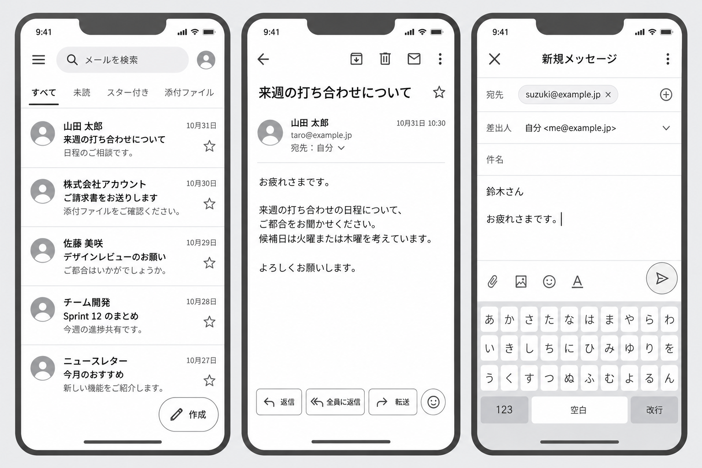
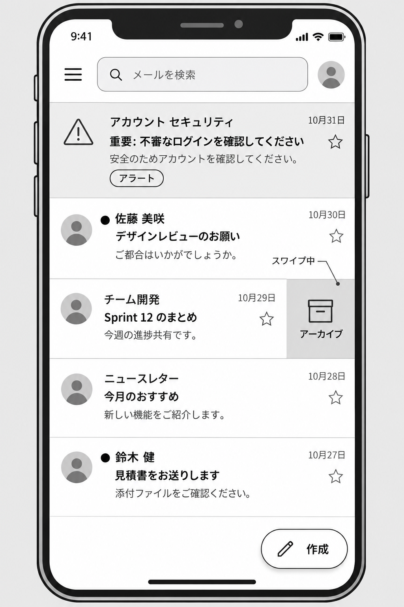

# gmail-redesign

手書きスケッチを出発点にした、Gmail モバイル UI の再設計コンセプトです。メールを「見つける・読む・返信する」という基本操作に集中できるよう、画面構成と操作の優先順位を見直します。

> ダミーデータで動く Web プロトタイプを[公開](https://nagata-minoru.github.io/gmail-redesign/)していますが、実際のメールは扱えません。Google の公式機能ではありません。

## 概要

既存のメール体験では、情報や操作が一画面に集まりやすく、重要なメールの発見や本文の閲覧に集中しにくい場面があります。本プロジェクトでは、モバイルでの利用を前提に、情報の強弱、直接操作、読みやすい余白を軸として Gmail の体験を再考します。

## 目標と設計原則

- **重要な情報を先に見せる**: 送信者、件名、アラート、日時などを整理し、優先度を素早く判断できるようにする。
- **よく使う操作を近くに置く**: スター、返信、転送、スワイプ操作を、画面遷移を増やさず実行できるようにする。
- **読むことを邪魔しない**: メール本文に集中できる、整理されたヘッダーと十分な余白を設ける。
- **状態を分かりやすく伝える**: 通知、空の受信トレイ、検索結果なしなどの状態を、言葉と視覚表現で明確にする。
- **ライト／ダークの両方で見やすくする**: 警告色、HTML メール、文字のコントラストをそれぞれのテーマで検討する。

## ワイヤーフレーム

画像はすべて `wireframes/` にあります。画面中の人名・メールアドレス・本文は架空のダミーデータです。

### 基本の 3 画面（受信トレイ・メール詳細・メール作成）



メールを一覧で見つけ、開いて読み、返信を書き始めるまでの流れを左から順に示しています。

### 受信トレイの状態表示



セキュリティ通知のアラート、未読の印、スワイプ中の行など、受信トレイで行ごとに異なる状態を 1 画面にまとめた案です。

## 想定する画面

### 1. 受信トレイ

- 検索、メニュー、アカウントへの入口を上部に集約
- 「すべて／未読／スター付き／添付ファイル」のタブで一覧を絞り込む案
- 送信者、件名、本文の冒頭、日時、スターを一覧で見やすく表示
- 未読メールは送信者名の前に印（●）を付けて区別する案
- 重要なセキュリティ通知などは、警告アイコン、「アラート」ラベル、背景色で目立たせる案
- 一覧からスターを直接切り替える
- 行を左にスワイプするとアーカイブ操作が現れる案
- 右下の作成ボタンから新規メッセージを開始

### 2. メール詳細

- 件名、送信者、受信日時を分かりやすく配置し、件名の横にスターを置く
- 戻る、アーカイブ、削除、未読、その他の操作を上部のツールバーに整理
- 返信、全員に返信、転送を画面下部にまとめて置く
- 下部の絵文字ボタンから短い反応を返す、絵文字リアクションの可能性を検討
- 本文を読みやすくし、ダークモードでの HTML メール表示も検討

### 3. メール作成

- 宛先、差出人、件名、本文を迷わず入力できる構成
- 宛先はチップで表示し、個別に削除・追加できるようにする
- 差出人欄に送信元アカウントを常に表示し、そこから切り替えられるようにする
- 添付、画像、絵文字、書式、送信の操作をキーボードのすぐ上に配置
- 日本語キーボード表示時にも本文と主要操作を確認できるレイアウトを検討

## 主なアイデア

| テーマ | 構想 |
| --- | --- |
| スター | 一覧と詳細の両方から、メールを開かずに近い感覚で素早く切り替える。 |
| スワイプ操作 | アーカイブや既読などの頻繁な処理を、一覧から直接行えるようにする。 |
| 重要度とアラート | セキュリティ通知などを識別しやすく表示し、ライト／ダーク両テーマで視認性を確保する。 |
| ダークモード | 文字、警告色、HTML メールのコントラストと読みやすさを検討する。 |
| Empty State | 受信トレイや検索結果が空のとき、状態を説明するメッセージと親しみやすいイラストを表示する。 |
| 絵文字リアクション | 返信文を書くほどではない短い反応を、軽く返せる可能性を探る。 |
| アカウント切り替え | 閲覧中・作成中ともに、どのアカウントを使っているかを明確にする。 |
| Gmail と Meet | メールと会議の行き来を自然にする連携を、探索的なテーマとして検討する。 |

## 現在のステータス

このリポジトリは、手書きスケッチを整理した **UI コンセプト／ローファイワイヤーフレーム** と、ダミーデータで動く **Web プロトタイプ** です。

### 実装済み（Web プロトタイプ）

- 受信トレイ：検索、絞り込みタブ（すべて／未読／スター付き／添付ファイル）、未読の印、アラート行、スターの切り替え、左スワイプでアーカイブ、検索結果なしと空の受信トレイの Empty State
- メール詳細：開くと既読、アーカイブ・削除・未読にする、スター、返信・全員に返信・転送、絵文字リアクション（試作）
- メール作成：宛先のチップ入力と形式チェック、差出人アカウントの切り替え、返信・転送時の件名と引用、入力中に閉じるときの破棄確認
- アーカイブ・削除の結果を画面下部に表示し、「元に戻す」で取り消せる
- ライト／ダークテーマ（端末の設定に従う）
- 受信トレイの上端に、非公式のコンセプトでデータはダミーであることを示す注記

Web プロトタイプは GitHub Pages で公開しています: <https://nagata-minoru.github.io/gmail-redesign/>

データはメモリ上のダミーだけで、ページを再読み込みすると初期状態に戻ります。送信もデモで、実際にはどこにも送られません。

### 未実装

- 実際のメール送受信
- Google アカウント認証・連携
- Gmail API や Meet との連携
- 新着メールの通知（バックエンドが必要）
- メニュー、添付・画像・書式の操作、HTML メールの表示

## 技術構成と開発

| 項目 | 内容 |
| --- | --- |
| フロントエンド | [Expo](https://expo.dev/)（React Native、Expo Router）。同じコードを Web と iOS／Android で動かせる |
| 公開先 | GitHub Pages（`main` への push で自動公開、`/gmail-redesign/` 以下）と Cloudflare Workers の静的アセット配信（`wrangler.jsonc`） |
| テスト | Node 標準のテスト（`node --test`）。画面に依存しない関数（絞り込み・検索、宛先の形式チェック、返信・転送の初期値、取り消しでの並び順の復元）とダミーデータを検証する |
| CI | GitHub Actions で型チェック・lint・Web ビルドとテスト（`.github/workflows/ci.yml`） |
| バックエンド | 現在はなし。通知などが必要になった段階で Ruby で用意する予定（Cloudflare 以外に配置） |

```sh
npm install          # 依存パッケージを入れる
npm run web          # 開発サーバを起動してブラウザで開く
npm run typecheck    # 型チェック
npm run lint         # ESLint
npm test             # テスト（src/ 以下の *.test.ts）
npm run build:web    # dist/ に静的ファイルを書き出す（ルートで配信する場合）
npm run build:pages  # GitHub Pages 向けに、/gmail-redesign/ 以下で動くよう書き出す
npm run deploy       # 書き出して Cloudflare に公開する（wrangler へのログインが必要）
```

配信するパスは、ビルド時の環境変数 `WEB_BASE_URL` で切り替えます（`app.config.ts`）。GitHub Pages への公開は `.github/workflows/pages.yml` が行います。

画面のコードは `src/app/`（`index.tsx` が受信トレイ、`mail/[id].tsx` がメール詳細、`compose.tsx` がメール作成）、ダミーデータは `src/data/mails.ts` にあります。画面に依存しない処理は `src/lib/` に置き、テストを隣に置いています（画面の描画や操作のテストは未整備です）。

## ロードマップ

- [x] 手書きスケッチの意図を整理する
- [x] 受信トレイ、メール詳細、メール作成の 3 画面をワイヤーフレーム化する
- [x] 受信トレイのアラート、未読、スワイプ中の表示をワイヤーフレーム化する
- [ ] スター、スワイプ、重要度表示の操作ルールを定義する
- [ ] ライト／ダークテーマと Empty State のビジュアルを検討する
- [x] 主要な画面遷移を含む操作可能なプロトタイプを作成する（Web、ダミーデータ）
- [x] Web プロトタイプを GitHub Pages で公開する
- [ ] Web プロトタイプを Cloudflare で公開する
- [ ] ユーザーテストを通じて情報階層と操作の分かりやすさを検証する

## 注意事項

`gmail-redesign` は個人による非公式のデザインコンセプトです。Google LLC、Gmail、Google Meet とは提携・後援・承認などの関係はありません。Gmail および Google Meet は Google LLC の商標です。
